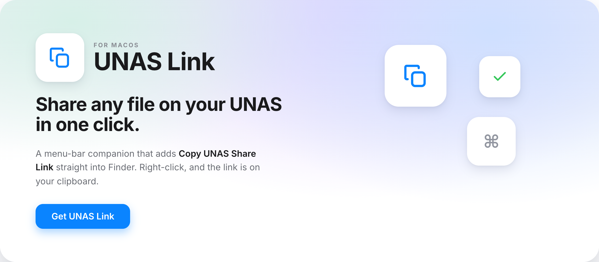
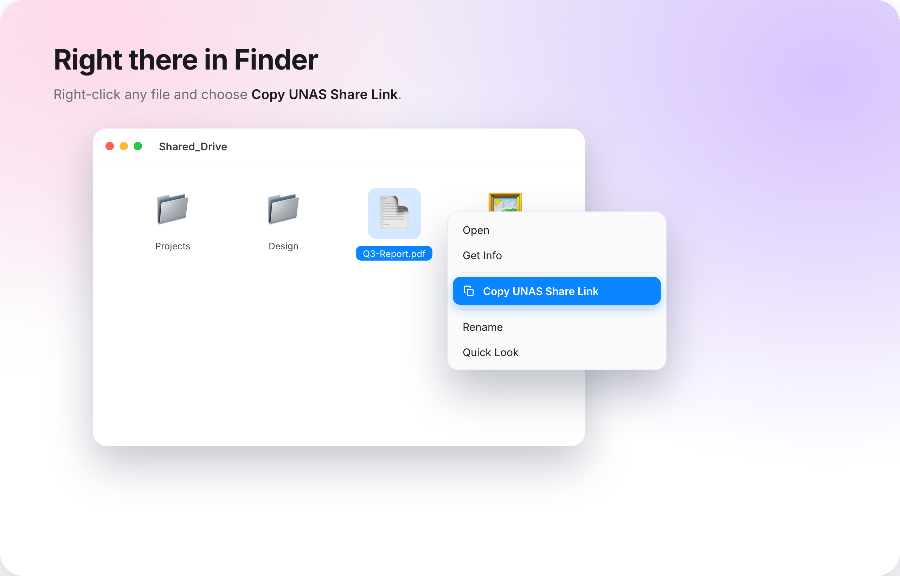
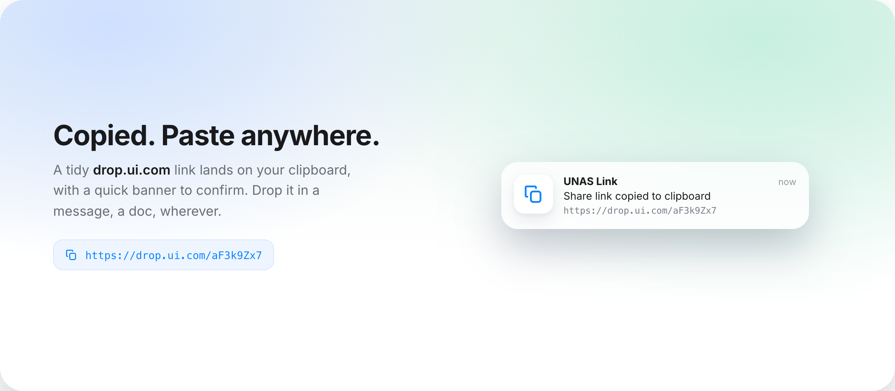

# UNAS Link for macOS



**Version 0.0.1 — very early experimental preview**

UNAS Link adds **Copy UNAS Share Link** to Finder for files on a mounted UniFi UNAS share. It asks UniFi Drive for an existing public link or creates one, places the resulting `drop.ui.com` URL on the clipboard, and confirms the copy with a macOS notification.

This project solves a small but persistent workflow gap: a file may already be visible in Finder over SMB, but creating a UniFi Drive share link normally means switching to the web interface, finding the same file again, and using Drive's sharing controls. UNAS Link connects the Finder path you already have to that sharing workflow.

> [!WARNING]
> This is an unofficial experiment, is not affiliated with or endorsed by Ubiquiti, and uses a private, undocumented UniFi Drive endpoint. A UniFi OS or Drive update can change or break that endpoint. Test it with non-sensitive files before relying on it.

## How it feels



1. Mount the UNAS share in Finder.
2. Right-click one file inside the configured mount.
3. Choose **Copy UNAS Share Link**.
4. Paste the resulting link wherever you need it.



## What is included

- A native SwiftUI menu-bar companion app
- A Finder Sync extension with a contextual menu action
- Persistent browser-based UNAS sign-in
- Session storage in the macOS Keychain
- Reuse of an existing public share for the same Drive path
- Creation of a new public share when one does not exist
- Clipboard copy and native notification feedback
- Launch-at-login and optional Dock visibility controls
- Support for a self-signed certificate on the exact configured UNAS host

## How authentication works

UNAS Link does not collect a UNAS username, password, or MFA code. When you choose **Sign In to UNAS**, it opens your configured UNAS address in a persistent `WKWebView`. You sign in directly to the real UniFi interface, including any MFA step UniFi requires.

After a successful login, UniFi OS sets its normal `TOKEN` session cookie. The app reads that cookie from WebKit's cookie store, validates the session's expiration, and saves the token in the macOS Keychain. The token contains the CSRF value required by the Drive request, so the app can make the same authenticated link-listing and link-creation calls as the web interface without storing your password.

The API client then:

1. Sends an authenticated `GET` to `/proxy/drive/api/v1/file-sharing/links` and looks for the selected Drive path.
2. Reuses the matching public share when one exists.
3. Otherwise sends a `POST` to the same endpoint with the public share type and Drive path.
4. Converts the returned share token into a `https://drop.ui.com/...` URL.

Sessions expire according to UniFi OS policy. A `401` response removes the old token and prompts for another browser sign-in. Refreshed session cookies returned by the UNAS are adopted automatically.

## Requirements

- macOS 14 Sonoma or newer
- Xcode with macOS development support
- An Apple account/team selected in Xcode for signing the app and Finder extension
- A UniFi UNAS share mounted in Finder
- Network access to the UNAS web interface

## Build with Xcode

1. Clone the repository:

   ```bash
   git clone https://github.com/blakecodes/Unifi-UNAS-Link-Copier-macOS.git
   cd Unifi-UNAS-Link-Copier-macOS
   ```

2. Open `UNASLink.xcodeproj` in Xcode.

3. Give the two targets identifiers that are unique to your Apple developer account. The checked-in `com.example` values are placeholders. For example:

   | Target | Example bundle identifier |
   | --- | --- |
   | `UNASLink` | `com.yourname.UNASLink` |
   | `UNASLinkFinderExtension` | `com.yourname.UNASLink.FinderExtension` |

4. Select the same development team for both targets under **Signing & Capabilities**.

5. Create an App Group such as `group.com.yourname.UNASLink` and enable it for both targets. Use that exact value in all three places:

   - `UNASLinkApp/UNASLink.entitlements`
   - `UNASLinkFinderExtension/UNASLinkFinderExtension.entitlements`
   - `UNASLinkConstants.appGroup` in `Shared/Constants.swift`

   You may also replace the `com.example` notification and Keychain service namespaces in `Shared/Constants.swift` and the URL type name in `UNASLinkApp/Info.plist` for consistency.

6. Select the **UNASLink** scheme with **My Mac** as the destination, then choose **Product → Run**.

7. If macOS does not enable the extension automatically, open **System Settings → General → Login Items & Extensions → Finder Extensions** and enable **UNASLinkFinderExtension**. Relaunch Finder if the menu item does not appear immediately.

For a standalone build, choose **Product → Archive**, distribute/copy the development build as appropriate for your signing setup, and place `UNASLink.app` in `/Applications`. Launch-at-login is most reliable after the app is in its permanent location.

## Configure the app

Open **Settings** from the UNAS Link menu-bar icon and provide:

| Value | Example | Meaning |
| --- | --- | --- |
| Server URL | `https://192.168.1.10` | Base URL used to reach UniFi OS on the UNAS. Do not add `/proxy/drive`. |
| Mounted Finder folder | `/Volumes/Shared_Drive` | Local root of the SMB share as Finder sees it. |
| UNAS Drive API root | `/shared/Shared_Drive` | The corresponding root path used internally by UniFi Drive. |
| Allow self-signed certificate | On only when required | Trusts the certificate challenge only when it comes from the exact configured host. |

The two path roots form a direct prefix mapping. For example:

```text
Finder: /Volumes/Shared_Drive/Public/example.zip
Drive:  /shared/Shared_Drive/Public/example.zip
```

After saving the configuration, choose **Sign In to UNAS**, complete the normal UniFi login in the browser window, and wait for the app to report that the session was saved. The credentials themselves are entered only into the UniFi page.

## Privacy and security notes

- The session token is stored in the macOS Keychain, not in UserDefaults, source files, or project settings.
- The API request uses an ephemeral `URLSession`; the browser uses WebKit's persistent website store so UniFi's login flow can work normally.
- Self-signed certificate bypass is opt-in and limited to the hostname in the configured Server URL. Leave it off when your UNAS has a certificate trusted by macOS.
- A `drop.ui.com` link is a bearer capability. Anyone who receives it may be able to download the shared file until the share is removed in UniFi Drive.
- Configuration is shared between the app and Finder extension through the configured App Group.
- Do not commit captured cookies, copied browser requests, signing certificates, provisioning profiles, or local configuration files. The repository ignore rules cover common variants, but review every commit.

## Current limitations

- The Drive endpoint is private and undocumented; compatibility is not guaranteed.
- The app supports one UNAS server and one mounted-root mapping at a time.
- The Finder action currently accepts one selected item at a time.
- There is no link-management UI; revoke or change shares in UniFi Drive.
- The app must be running or launchable for the Finder extension to hand off a copy request.
- This preview is intended for development and testing, not production deployment.

## Troubleshooting

**The Finder command is missing**

- Confirm the Finder extension is enabled in System Settings.
- Confirm the selected file is beneath the configured mounted Finder folder.
- Relaunch Finder or sign out and back in after first enabling the extension.

**The app asks me to sign in again**

- The UniFi session may have expired or been invalidated. Use **Sign In to UNAS** again.

**The request returns an HTTP error**

- Confirm the Server URL and both path roots.
- Check that the file appears at the mapped path in UniFi Drive.
- A UniFi Drive update may have changed the private endpoint or its response format.

**Xcode reports an App Group or signing error**

- Make sure both targets use your team, unique bundle identifiers, and the same App Group.
- Make sure the App Group string in `Shared/Constants.swift` exactly matches both entitlements.

## Status

`0.0.1` is deliberately an extremely early version. Expect rough edges and breaking changes while the UNAS behavior and macOS integration are tested across more machines.

UniFi, UniFi Drive, UNAS, and Ubiquiti are trademarks of their respective owner. This repository is an independent community project.
